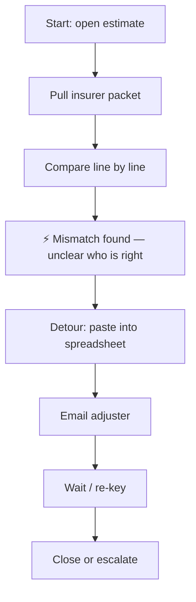
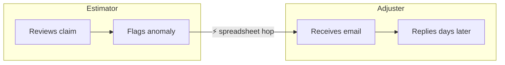
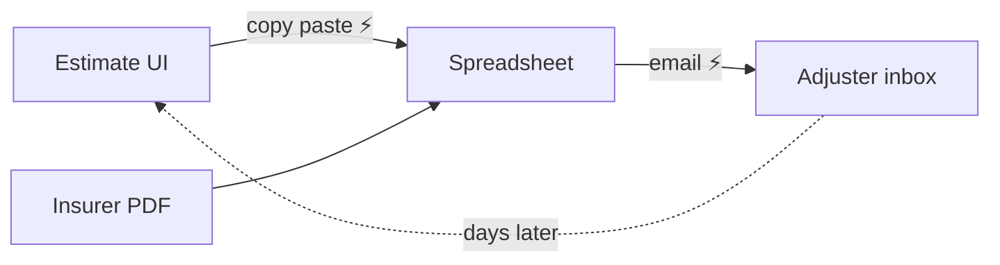

# Diagram recipes — current state only

Frame diagrams show **today**: frictions, detours, fragmentation. Never the aspirational future (that is concepting). Embed Mermaid in `problem.md` always; FigJam is an offer after review.

## Actor workflow (required for most problems)

Mark friction with `⚡` at the step where it occurs. Draw the workaround as a detour, not a footnote.

Multi-actor: use subgraphs as swimlanes.

## Artifact map (when information fragmentation is the pain)

Documents/systems the actor touches and what hops between them.

## Rules

- At least one ⚡ on a current-state diagram — no markers means decoration.
- Real labels from the noun table / evidence — not "System A".
- Boxes, arrows, labels only — no styling passes on a framing diagram.
- Aspirational "to-be" flows belong in concepting, not `problem.md`.

## Before you finish

| Mistake | Fix |
|---|---|
| Future-state diagram at framing | Redraw today with detours |
| No ⚡ | Mark where evidence says pain lives |
| Generic node names | Use real nouns |
| FigJam before brief review | Mermaid in problem.md first; offer push |
